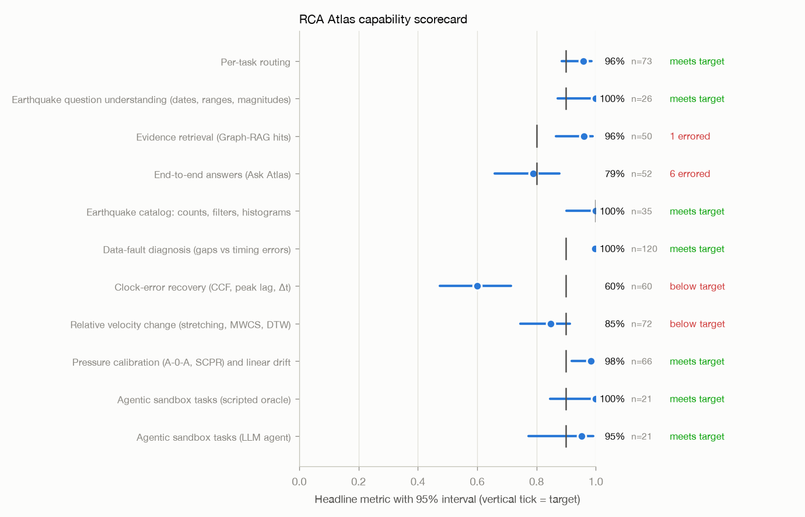
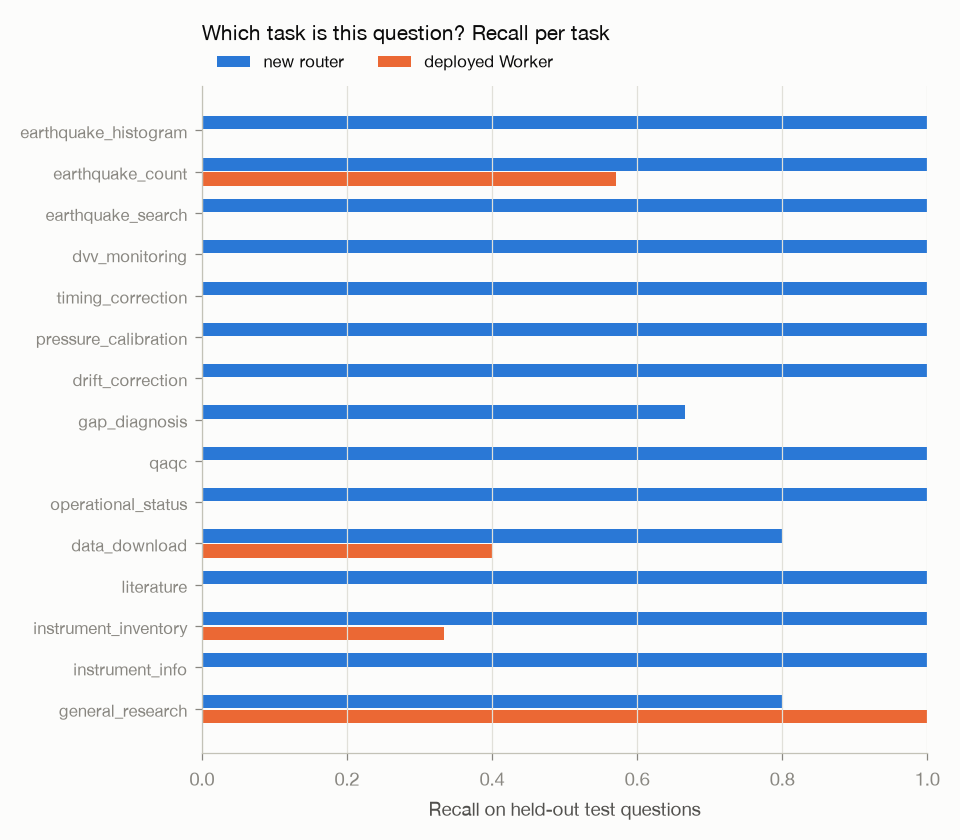
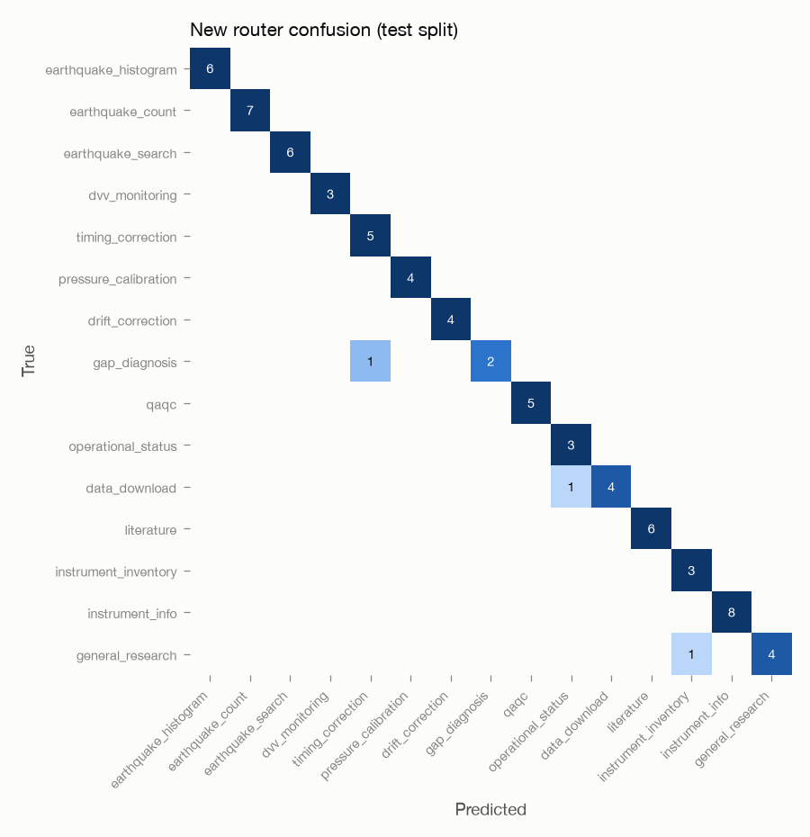
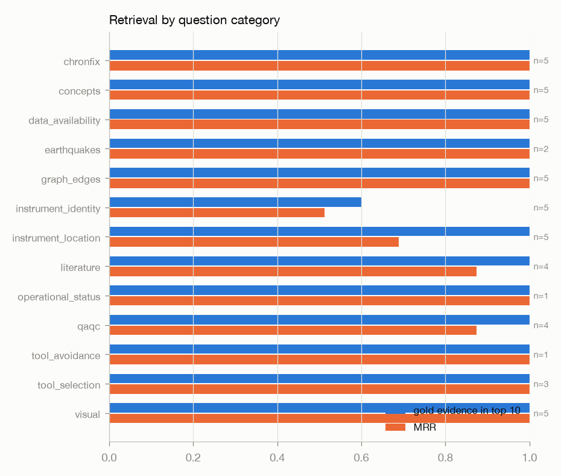
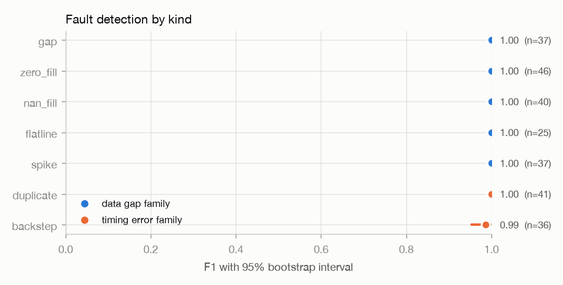
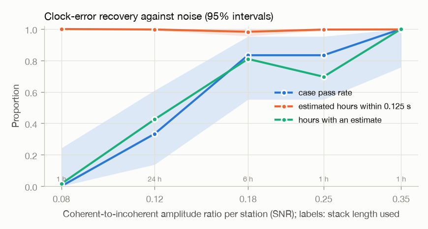
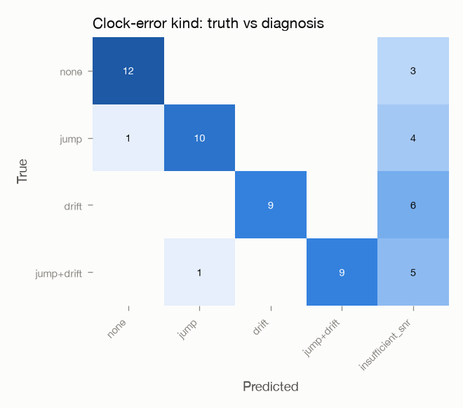
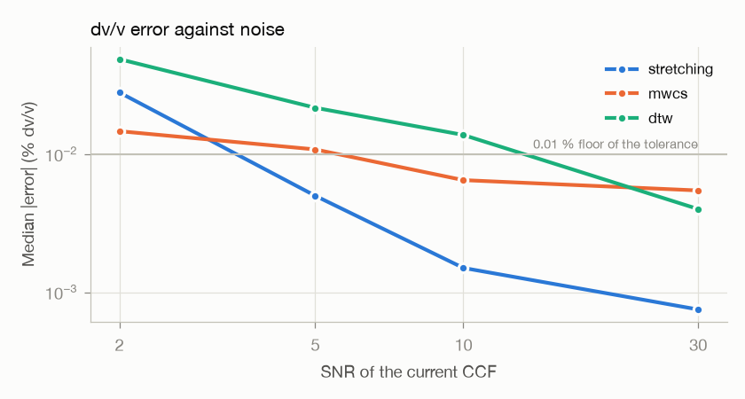
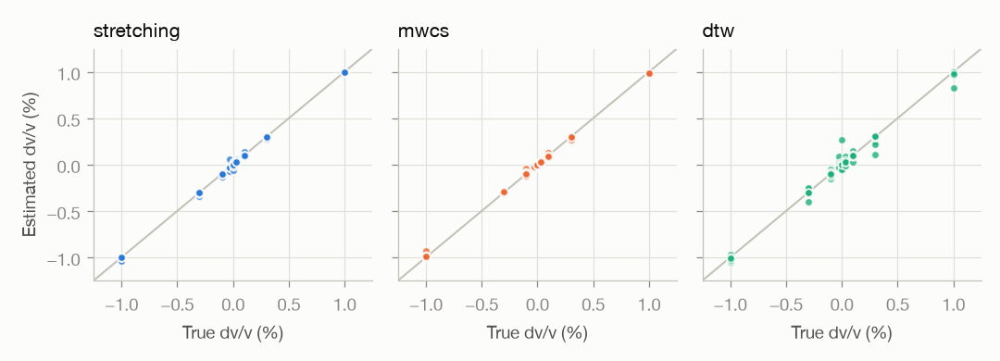
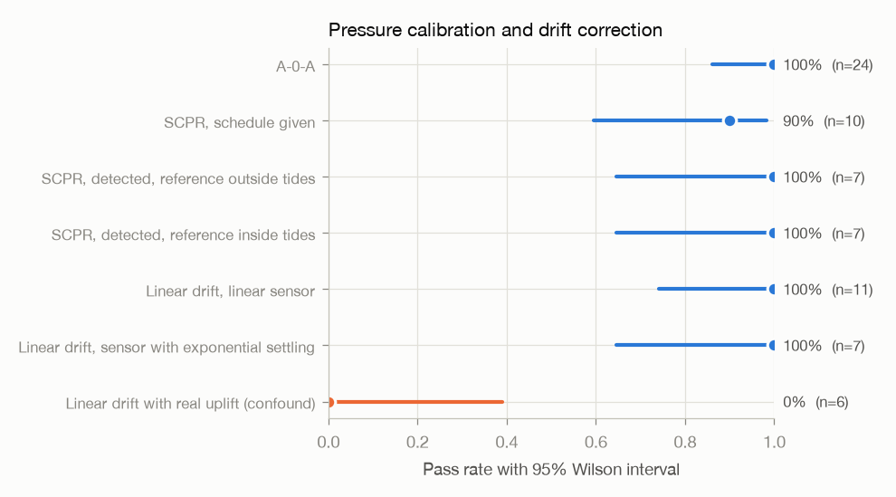

# RCA Atlas evaluation — 2026-10-08-baseline

Run created 2026-10-08T22:36:35.177055+00:00 on commit `6ec3432b22` (uncommitted changes), branch `rca-atlas-eval-suite`. Every value is a point estimate with a 95% interval (Wilson for proportions, case bootstrap otherwise). Method: `src/atlas_eval/EVALUATION_METHOD.md`.

## Scorecard

| Capability | Axis | Headline metric | Value [95% CI] | n | Status |
|---|---|---|---|---|---|
| Per-task routing | routing | Accuracy, new router, held-out test | 96% [89%, 99%] | 73 | meets 90% |
| Earthquake question understanding (dates, ranges, magnitudes) | robustness | Correct date range and magnitude, new parser | 100% [87%, 100%] | 26 | meets 90% |
| Evidence retrieval (Graph-RAG hits) | retrieval | Gold evidence in top 10 (any required chunk) | 96% [87%, 99%] | 50 | **1 case(s) errored** |
| End-to-end answers (Ask Atlas) | answer quality | Judge: correct against the reference answer | 79% [66%, 88%] | 52 | **6 case(s) errored** |
| Earthquake catalog: counts, filters, histograms | accuracy | Count and histogram exactly right | 100% [90%, 100%] | 35 | meets 100% |
| Data-fault diagnosis (gaps vs timing errors) | detection | Fault detection F1 (all kinds, micro) | 100% [99%, 100%] | 120 | meets 90% |
| Clock-error recovery (CCF, peak lag, Δt) | accuracy | Case pass rate (diagnosis right, jump found, ≥95% of estimated hours within 1 sample) | 60% [47%, 71%] | 60 | **below 90%** |
| Relative velocity change (stretching, MWCS, DTW) | accuracy | stretching: pass rate | 85% [75%, 91%] | 72 | **below 90%** |
| Pressure calibration (A-0-A, SCPR) and linear drift | accuracy | Pass rate, all calibration and drift cases (excl. uplift confound) | 98% [92%, 100%] | 66 | meets 90% |
| Agentic sandbox tasks (scripted oracle) | task success | Task success (oracle) | 100% [85%, 100%] | 21 | meets 90% |
| Agentic sandbox tasks (LLM agent) | task success | Task success (claude:haiku) | 95% [77%, 99%] | 21 | meets 90% |

## Per-task routing

**Capability.** Recognise which task a question is, so the right tool or prompt answers it.  **Axis.** routing.  **Cases.** 156 (0 errored).  **Dataset.** `routing_v1.jsonl` (sha256 `8bd5764c024b`)

156 questions labelled with one of 15 task types (10–12 each, written before the rules, half paraphrased without the obvious keyword). The new rule-based router (`atlas_tasks/router_rules.json`) was tuned on the dev half only and is scored on the held-out test half. The baseline is the deployed Worker's own decision logic (live day count → named download / compact → inventory → research), run unchanged through Node.

| Metric | Value [95% CI] | n | Target |
|---|---|---|---|
| Accuracy, new router, held-out test | 96% [89%, 99%] | 73 | meets 90% |
| Accuracy, deployed Worker, held-out test | 16% [10%, 27%] | 73 |  |
| Accuracy, new router, dev (rules tuned here) | 100% [96%, 100%] | 83 |  |
| Accuracy, deployed Worker, dev (rules tuned here) | 16% [9%, 25%] | 83 |  |
| Macro-F1 over 15 tasks, new router, test | 95% [87%, 100%] | 73 |  |
| Macro-F1 over 15 tasks, deployed Worker, test | 13% [6%, 18%] | 73 |  |
| Accuracy on paraphrased (hard) test questions, new router | 97% [84%, 99%] | 32 |  |

- McNemar, new router vs deployed Worker on the test split: router-only correct 59, Worker-only correct 1, p = 1.1e-16.
- The Worker has no route for 11 of the 15 tasks, so its ceiling on this set is the share of questions in its four classes; the comparison shows coverage, not a tuned competitor.

per task

| task | n | router_recall | worker_recall |
|---|---|---|---|
| earthquake_histogram | 6 | 1.000 | 0.000 |
| earthquake_count | 7 | 1.000 | 0.571 |
| earthquake_search | 6 | 1.000 | 0.000 |
| dvv_monitoring | 3 | 1.000 | 0.000 |
| timing_correction | 5 | 1.000 | 0.000 |
| pressure_calibration | 4 | 1.000 | 0.000 |
| drift_correction | 4 | 1.000 | 0.000 |
| gap_diagnosis | 3 | 0.667 | 0.000 |
| qaqc | 5 | 1.000 | 0.000 |
| operational_status | 3 | 1.000 | 0.000 |
| data_download | 5 | 0.800 | 0.400 |
| literature | 6 | 1.000 | 0.000 |
| instrument_inventory | 3 | 1.000 | 0.333 |
| instrument_info | 8 | 1.000 | 0.000 |
| general_research | 5 | 0.800 | 1.000 |

router misses

| question | gold | router |
|---|---|---|
| Find missing samples and timing jitter in the VEL3D record. | gap_diagnosis | timing_correction |
| Can I access multi-span DAS recordings? | data_download | operational_status |
| How are RCA sites, nodes, and instruments connected? | general_research | instrument_inventory |

## Earthquake question understanding (dates, ranges, magnitudes)

**Capability.** Understand which days and magnitudes 'how many earthquakes' means.  **Axis.** robustness.  **Cases.** 26 (0 errored).  **Dataset.** `quake_questions_v1.jsonl` (sha256 `09aee219a721`)

26 count questions with the intended UTC date range and magnitude floor (or none, when the question names no period), at a fixed 'now' of 2026-09-25 12:00 UTC. The deployed Worker's `axialDayWindow` (run unchanged through Node) is compared with the new `parse_quake_request`. The Worker answers a count only for one day and ignores magnitude, so a range or a magnitude filter it accepts is counted wrong, and a question it lets fall to the language model is not a count.

| Metric | Value [95% CI] | n | Target |
|---|---|---|---|
| Correct date range and magnitude, new parser | 100% [87%, 100%] | 26 | meets 90% |
| Correct date range and magnitude, deployed Worker | 31% [17%, 50%] | 26 |  |
| Range or magnitude questions, deployed Worker | 0% [0%, 24%] | 12 |  |

- McNemar new vs Worker: new-only 18, Worker-only 0, p = 7.6e-06.

disagreements

| question | expected | worker | parser |
|---|---|---|---|
| How many earthquakes at Axial between 2026-09-23 and 2026-09-24? | {"end": "2026-09-24", "min_mag": null, "start": "2026-09-23"} | {"end": "2026-09-23", "min_mag": null, "start": "2026-09-23"} | {"end": "2026-09-24", "min_mag": null, "start": "2026-09-23"} |
| How many Axial earthquakes from 2026-09-20 to 2026-09-24? | {"end": "2026-09-24", "min_mag": null, "start": "2026-09-20"} | {"end": "2026-09-20", "min_mag": null, "start": "2026-09-20"} | {"end": "2026-09-24", "min_mag": null, "start": "2026-09-20"} |
| How many earthquakes at Axial since 2026-09-20? | {"end": "2026-09-25", "min_mag": null, "start": "2026-09-20"} | {"end": "2026-09-20", "min_mag": null, "start": "2026-09-20"} | {"end": "2026-09-25", "min_mag": null, "start": "2026-09-20"} |
| How many Axial earthquakes in the last 7 days? | {"end": "2026-09-25", "min_mag": null, "start": "2026-09-19"} | None | {"end": "2026-09-25", "min_mag": null, "start": "2026-09-19"} |
| How many Axial earthquakes in the past 3 days? | {"end": "2026-09-25", "min_mag": null, "start": "2026-09-23"} | None | {"end": "2026-09-25", "min_mag": null, "start": "2026-09-23"} |
| How many earthquakes did Axial have last week? | {"end": "2026-09-25", "min_mag": null, "start": "2026-09-19"} | None | {"end": "2026-09-25", "min_mag": null, "start": "2026-09-19"} |
| How many Axial earthquakes on 2026-09-24 above magnitude 1? | {"end": "2026-09-24", "min_mag": 1.0, "start": "2026-09-24"} | {"end": "2026-09-24", "min_mag": null, "start": "2026-09-24"} | {"end": "2026-09-24", "min_mag": 1.0, "start": "2026-09-24"} |
| How many Axial earthquakes yesterday with magnitude greater than 0.5? | {"end": "2026-09-24", "min_mag": 0.5, "start": "2026-09-24"} | {"end": "2026-09-24", "min_mag": null, "start": "2026-09-24"} | {"end": "2026-09-24", "min_mag": 0.5, "start": "2026-09-24"} |
| How many M>1.5 Axial earthquakes since 2026-09-01? | {"end": "2026-09-25", "min_mag": 1.5, "start": "2026-09-01"} | {"end": "2026-09-01", "min_mag": null, "start": "2026-09-01"} | {"end": "2026-09-25", "min_mag": 1.5, "start": "2026-09-01"} |
| How many quakes at Axial yesterday? | {"end": "2026-09-24", "min_mag": null, "start": "2026-09-24"} | None | {"end": "2026-09-24", "min_mag": null, "start": "2026-09-24"} |
| How many Axial events were located yesterday? | {"end": "2026-09-24", "min_mag": null, "start": "2026-09-24"} | None | {"end": "2026-09-24", "min_mag": null, "start": "2026-09-24"} |
| Number of Axial Seamount earthquakes on September 24, 2026 | {"end": "2026-09-24", "min_mag": null, "start": "2026-09-24"} | None | {"end": "2026-09-24", "min_mag": null, "start": "2026-09-24"} |
| How many Axial earthquakes on Sept 23? | {"end": "2026-09-23", "min_mag": null, "start": "2026-09-23"} | None | {"end": "2026-09-23", "min_mag": null, "start": "2026-09-23"} |
| How many Axial earthquakes on 9/24/2026? | {"end": "2026-09-24", "min_mag": null, "start": "2026-09-24"} | None | {"end": "2026-09-24", "min_mag": null, "start": "2026-09-24"} |
| How many earthquakes happened at Axial the day before yesterday? | {"end": "2026-09-23", "min_mag": null, "start": "2026-09-23"} | {"end": "2026-09-24", "min_mag": null, "start": "2026-09-24"} | {"end": "2026-09-23", "min_mag": null, "start": "2026-09-23"} |
| How many Axial earthquakes in September 2026? | {"end": "2026-09-25", "min_mag": null, "start": "2026-09-01"} | None | {"end": "2026-09-25", "min_mag": null, "start": "2026-09-01"} |
| How many Axial earthquakes this month? | {"end": "2026-09-25", "min_mag": null, "start": "2026-09-01"} | None | {"end": "2026-09-25", "min_mag": null, "start": "2026-09-01"} |
| How many Axial earthquakes last month? | {"end": "2026-08-31", "min_mag": null, "start": "2026-08-01"} | None | {"end": "2026-08-31", "min_mag": null, "start": "2026-08-01"} |

## Evidence retrieval (Graph-RAG hits)

**Capability.** Search and retrieve the right corpus evidence for a question.  **Axis.** retrieval.  **Cases.** 60 (1 errored).  **Dataset.** `../../model_eval/datasets/rca_eval_v1.jsonl` (sha256 `e21437c05912`)

The 60 questions of `model_eval/datasets/rca_eval_v1.jsonl` sent to the live Worker in quick mode (retrieval and graph only, no language model). Gold chunk IDs come from `rca_eval_v1_gold.jsonl`; questions without gold chunks are scored only on collections and tool hints. Tool hints are the `/v1/tools` router's suggestions, checked for questions that need a tool (v1 tool names mapped to the tools that exist).

| Metric | Value [95% CI] | n | Target |
|---|---|---|---|
| Gold evidence in top 10 (any required chunk) | 96% [87%, 99%] | 50 | meets 80% |
| Recall@5 of required chunks | 91% [83%, 97%] | 50 |  |
| Recall@10 of required chunks | 93% [86%, 98%] | 50 |  |
| MRR of first required chunk | 90% [82%, 96%] | 50 |  |
| Expected collection in top 10 | 81% [70%, 89%] | 59 |  |
| Tool router suggests the needed tool | 0% [0%, 19%] | 16 |  |
| Tool router suggests any tool when one is needed | 0% [0%, 19%] | 16 |  |
| Latency p50 (quick mode) | 0.757 s | 59 |  |
| Latency p95 (quick mode) | 1.1 s | 59 |  |
| Request success rate | 98% [91%, 100%] | 60 |  |

- v1 expected tools with no implementation at all: nereus_file_status, nereus_ping_status.

per category

| category | n | hit_at_10 | recall_at_10 | mrr |
|---|---|---|---|---|
| chronfix | 5 | 1.000 | 0.800 | 1.000 |
| concepts | 5 | 1.000 | 0.900 | 1.000 |
| data_availability | 5 | 1.000 | 1.000 | 1.000 |
| earthquakes | 2 | 1.000 | 1.000 | 1.000 |
| graph_edges | 5 | 1.000 | 1.000 | 1.000 |
| instrument_identity | 5 | 0.600 | 0.600 | 0.513 |
| instrument_location | 5 | 1.000 | 1.000 | 0.689 |
| literature | 4 | 1.000 | 1.000 | 0.875 |
| operational_status | 1 | 1.000 | 1.000 | 1.000 |
| qaqc | 4 | 1.000 | 1.000 | 0.875 |
| tool_avoidance | 1 | 1.000 | 1.000 | 1.000 |
| tool_selection | 3 | 1.000 | 1.000 | 1.000 |
| visual | 5 | 1.000 | 1.000 | 1.000 |

errors (1)

| case | error |
|---|---|
| earthquake-001 | HTTP 503 |

## End-to-end answers (Ask Atlas)

**Capability.** Answer research, inventory, download, and task questions with cited evidence.  **Axis.** answer quality.  **Cases.** 72 (6 errored).  **Dataset.** `answers_extra_v1.jsonl` (sha256 `405663a49ba1`)

The 60 v1 questions plus the task questions from Maleen's notes, sent to the live Worker with the default model route. Automatic checks: the request is served; every [n] citation points at a listed source; the plain-text format the prompt demands (no Markdown asterisks or hashes); gold entities and gold sources appear. For questions that need a computation the Worker cannot run, the answer must not state a computed number. An optional LLM judge grades correctness against the reference answer and support by the retrieved evidence.

| Metric | Value [95% CI] | n | Target |
|---|---|---|---|
| Served on the first attempt | 65% [54%, 75%] | 72 | **below 98%** |
| Judge: correct against the reference answer — score ≥ 1 of 2 (partially or fully correct) | 79% [66%, 88%] | 52 | **below 80%** |
| Judge: fully correct | 19% [11%, 32%] | 52 |  |
| Judge: every claim supported by the public excerpts (lower bound) — the judge sees 280-character excerpts; the answering model saw full chunks | 48% [36%, 61%] | 62 |  |
| Judge: says it cannot compute instead of inventing a value (tool questions) | 63% [44%, 78%] | 27 |  |
| Served after one slower retry | 92% [83%, 96%] | 72 |  |
| Every citation points at a listed source (answers that cite) | 100% [94%, 100%] | 63 | meets 100% |
| Empty answers | 0% [0%, 6%] | 66 |  |
| Corpus answers carry at least one citation | 100% [91%, 100%] | 41 |  |
| Plain-text format the prompt requires | 55% [43%, 66%] | 66 |  |
| Gold entities named in the answer | 100% [100%, 100%] | 21 |  |
| Gold sources among the answer's citations | 94% [86%, 100%] | 18 |  |
| Computation questions with no numeric claim at all (regex; also flags quoted literature values) | 60% [31%, 83%] | 10 |  |
| Latency p50 | 3.6 s | 66 |  |
| Latency p95 | 17 s | 66 |  |

per category

| category | n | format_ok | citations_valid | judge_correct |
|---|---|---|---|---|
| chronfix | 4 | 0.000 | 1.000 | 1.000 |
| concepts | 5 | 0.600 | 1.000 | 1.000 |
| data_availability | 5 | 0.800 | 1.000 | 0.600 |
| earthquakes | 4 | 0.750 | 1.000 | 0.500 |
| full_text | 1 | 1.000 | 1.000 | 0.000 |
| graph_edges | 5 | 0.400 | 1.000 | 1.000 |
| instrument_identity | 5 | 1.000 | 1.000 | 1.000 |
| instrument_location | 5 | 1.000 | 1.000 | 1.000 |
| literature | 4 | 0.250 | 1.000 | 0.750 |
| notes_task | 10 | 0.400 | 1.000 | None |
| operational_status | 4 | 0.500 | 1.000 | 0.500 |
| qaqc | 5 | 0.400 | 1.000 | 0.800 |
| tool_avoidance | 1 | 1.000 | 1.000 | 1.000 |
| tool_selection | 3 | 0.333 | 1.000 | 1.000 |
| visual | 5 | 0.400 | 1.000 | 0.600 |

answer models

| model | n |
|---|---|
| gemini-2.5-flash | 21 |
| Groq GPT-OSS 120B | 45 |

invented numbers

| question | answer |
|---|---|
| Estimate the seismic velocity change at the Axial summit using MWCS for 2026. | **Direct answer**   The available evidence does not provide a measurable seismic‑velocity change at the Axial summit for 2026 using moving‑window cross‑spectral |
| Apply the A0A calibration to the Central Caldera pressure record and report the drift rate in kPa per year. | **Direct answer**   The retrieved evidence does not contain a quantified drift rate (in kPa yr⁻¹) for the A‑0‑A calibrated pressure instrument (A0A) at the Cent |
| What drift correction does the SCPR calibration give for the Central Caldera? | **Direct answer**   The Self‑Calibrating Pressure Recorder (SCPR) at the Axial Seamount Central Caldera removes instrument drift by applying an in‑situ piston‑g |
| What is the linear drift of the Axial Base PREST pressure sensor in kPa per year? | **Answer:**   The retrieved evidence does not provide a specific linear drift value for the Axial Base PREST pressure sensor. The only drift figures reported ar |

errors (6)

| case | error |
|---|---|
| chronfix-004 | HTTP 503 |
| earthquake-001 | HTTP 503 |
| status-002 | HTTP 503 |
| tool-003 | HTTP 503 |
| notes-09 | HTTP 503 |
| notes-12 | HTTP 503 |

## Earthquake catalog: counts, filters, histograms

**Capability.** How many earthquakes; histogram panel for date ranges.  **Axis.** accuracy.  **Cases.** 35 (0 errored).  **Dataset.** `quakes_v1.jsonl` (sha256 `bdf6508449f9`)

Count, filter, and histogram questions over the three committed UW hypo71 fixture days plus 24 synthetic days with edge rows (60.00 s rollover, negative magnitudes, short rows, rows dated another day, a non-numeric value, CRLF and blank lines). Truth comes from an independent plain reading of the catalog rule. The same files are also parsed by the two shipping parsers (`axial_agent_tools.parse_hypo71` and the Worker's `parseHypo71Events`) to measure agreement.

| Metric | Value [95% CI] | n | Target |
|---|---|---|---|
| Count and histogram exactly right | 100% [90%, 100%] | 35 | meets 100% |
| Count exactly right (with missing days reported) | 100% [90%, 100%] | 35 |  |
| Histogram exactly right | 100% [90%, 100%] | 35 |  |
| Unfiltered day count agrees with the catalog rule: atlas_tasks | 100% [90%, 100%] | 35 |  |
| Unfiltered day count agrees with the catalog rule: axial_agent_tools | 91% [78%, 97%] | 35 |  |
| Unfiltered day count agrees with the catalog rule: worker_js | 91% [78%, 97%] | 35 |  |

implementations

| implementation | agreement | disagrees_on |
|---|---|---|
| atlas_tasks | 1.000 | [] |
| axial_agent_tools | 0.914 | ["bad_number"] |
| worker_js | 0.914 | ["bad_number"] |

## Data-fault diagnosis (gaps vs timing errors)

**Capability.** Diagnose the type of error in a record: data gaps or timing errors.  **Axis.** detection.  **Cases.** 120 (0 errored).  **Dataset.** `gaps_v1.jsonl` (sha256 `d882bde3a4f4`)

Each case is a regularly sampled record (0.125–60 s period) with 0–4 injected faults of seven kinds. A finding counts when its kind matches and its interval overlaps the truth within 1.5 sample periods. The existing `coszo_pressure_detect_gaps` (anomaly algorithm) is scored on the `gap` kind as a baseline.

| Metric | Value [95% CI] | n | Target |
|---|---|---|---|
| Fault detection F1 (all kinds, micro) | 100% [99%, 100%] | 120 | meets 90% |
| Error-type verdict accuracy (gap / timing / both / clean) | 100% [97%, 100%] | 120 | meets 90% |
| Cases diagnosed exactly (no miss, no false alarm) | 99% [95%, 100%] | 120 |  |
| Gap F1: new diagnose_series | 100% [100%, 100%] | 120 |  |
| Gap F1: existing coszo_pressure_detect_gaps — 0 case(s) rejected by the baseline | 100% [100%, 100%] | 120 |  |

- McNemar on per-case exact gap detection, new vs existing: new-only 0, existing-only 0, p = 1.

per kind

| kind | family | truth | found | tp | precision | recall | f1 | f1_low | f1_high |
|---|---|---|---|---|---|---|---|---|---|
| gap | data_gap | 37 | 37 | 37 | 1.000 | 1.000 | 1.000 | 1.000 | 1.000 |
| zero_fill | data_gap | 46 | 46 | 46 | 1.000 | 1.000 | 1.000 | 1.000 | 1.000 |
| nan_fill | data_gap | 40 | 40 | 40 | 1.000 | 1.000 | 1.000 | 1.000 | 1.000 |
| flatline | data_gap | 25 | 25 | 25 | 1.000 | 1.000 | 1.000 | 1.000 | 1.000 |
| spike | data_gap | 37 | 37 | 37 | 1.000 | 1.000 | 1.000 | 1.000 | 1.000 |
| duplicate | timing_error | 41 | 41 | 41 | 1.000 | 1.000 | 1.000 | 1.000 | 1.000 |
| backstep | timing_error | 36 | 35 | 35 | 1.000 | 0.972 | 0.986 | 0.954 | 1.000 |

## Clock-error recovery (CCF, peak lag, Δt)

**Capability.** Perform cross-correlation, compute peak lags, and correct timing errors.  **Axis.** accuracy.  **Cases.** 60 (0 errored).  **Dataset.** `timing_v1.jsonl` (sha256 `0a7e3efec628`)

Each case is a three-day 8 Hz station pair recording one diffuse wavefield; station B has a known hourly clock error (none, a jump, a linear drift, or both) and some cases have zero-filled hours. The SNR grid brackets the detection limit of hourly stacks. The chronos-equivalent pipeline must recover Δt(B); it may decline to pick noisy bins (pick-quality gate) and may stack longer (6 h, 1 day) when hours are too noisy. Each hour is scored with the estimate of the bin that holds it. Because the CCF only constrains Δt relative to an anchor period, errors are measured after removing their median. 'Confidently wrong' hours carry an estimate more than 0.5 s off.

| Metric | Value [95% CI] | n | Target |
|---|---|---|---|
| Case pass rate (diagnosis right, jump found, ≥95% of estimated hours within 1 sample) | 60% [47%, 71%] | 60 | **below 90%** |
| Hours with an estimate (coverage) | 59% [49%, 68%] | 4286 |  |
| Estimated hours within one sample (0.125 s) | 99% [99%, 100%] | 2525 | meets 95% |
| Estimated hours confidently wrong (> 0.5 s) | 0% [0%, 0%] | 2525 | meets 2% |
| Error-kind classification accuracy | 67% [54%, 77%] | 60 | **below 90%** |
| Cases declined as too noisy to pick | 30% [20%, 43%] | 60 |  |
| Clock-jump detection F1 (±2 h or one bin) | 72% [54%, 86%] | 60 |  |
| Jump size absolute error | 0.0988 s [0.0553, 0.15] | 18 |  |
| Drift rate absolute error | 0.0137 s/day [0.0049, 0.0266] | 19 |  |

- Accuracy is over the hours that received an estimate; coverage says how many did. A bin whose pick quality is below the noise-only 99th percentile is left empty instead of guessed.

by snr

| snr | n | pass | pass_low | pass_high | hourly_acc | hourly_low | hourly_high | coverage | stack_hours | kind_acc |
|---|---|---|---|---|---|---|---|---|---|---|
| 0.080 | 12 | 0.000 | 0.000 | 0.242 | 1.000 | 1.000 | 1.000 | 0.015 | 1.000 | 0.000 |
| 0.120 | 12 | 0.333 | 0.138 | 0.609 | 0.997 | 0.991 | 1.000 | 0.425 | 24.0 | 0.333 |
| 0.180 | 12 | 0.833 | 0.552 | 0.953 | 0.983 | 0.955 | 1.000 | 0.810 | 6.000 | 1.000 |
| 0.250 | 12 | 0.833 | 0.552 | 0.953 | 0.997 | 0.991 | 1.000 | 0.697 | 1.000 | 1.000 |
| 0.350 | 12 | 1.000 | 0.758 | 1.000 | 0.998 | 0.994 | 1.000 | 1.000 | 1.000 | 1.000 |

## Relative velocity change (stretching, MWCS, DTW)

**Capability.** Measure dv/v by stretching, MWCS, and dynamic time warping.  **Axis.** accuracy.  **Cases.** 72 (0 errored).  **Dataset.** `dvv_v1.jsonl` (sha256 `bbc7572f3149`)

Each case stretches a synthetic CCF (ballistic arrivals plus exponential coda) by a known dv/v between −1 % and +1 % and adds noise at a given SNR. A method passes when |error| ≤ 0.01 % + 10 % of |dv/v|. Uncertainty calibration checks how often |error| ≤ 2 × the method's reported σ.

| Metric | Value [95% CI] | n | Target |
|---|---|---|---|
| stretching: pass rate | 85% [75%, 91%] | 72 | **below 90%** |
| stretching: mean |error| | 0.009486 % dv/v [0.00618, 0.01357] | 72 |  |
| mwcs: pass rate | 93% [85%, 97%] | 72 | meets 90% |
| mwcs: mean |error| | 0.0113 % dv/v [0.00866, 0.0144] | 72 |  |
| dtw: pass rate | 62% [51%, 73%] | 72 | **below 90%** |
| dtw: mean |error| | 0.0315 % dv/v [0.0221, 0.043] | 72 |  |

- Coverage near 95 % means the reported σ is honest; far below means it is overconfident.

by method

| method | pass | pass_low | pass_high | mae_pct | bias_pct | bias_low | bias_high | coverage_2sigma | coverage_low | coverage_high |
|---|---|---|---|---|---|---|---|---|---|---|
| stretching | 0.847 | 0.747 | 0.912 | 0.009 | -0.000 | -0.004 | 0.004 | 0.986 | 0.925 | 0.998 |
| mwcs | 0.931 | 0.848 | 0.970 | 0.011 | 0.000 | -0.003 | 0.004 | 0.639 | 0.524 | 0.740 |
| dtw | 0.625 | 0.510 | 0.728 | 0.032 | -0.004 | -0.016 | 0.010 | 1.000 | 0.949 | 1.000 |

by snr

| snr | stretching | stretching_pass | mwcs | mwcs_pass | dtw | dtw_pass |
|---|---|---|---|---|---|---|
| 2 | 0.028 | 0.556 | 0.015 | 0.722 | 0.049 | 0.278 |
| 5 | 0.005 | 0.833 | 0.011 | 1.000 | 0.022 | 0.556 |
| 10 | 0.001 | 1.000 | 0.006 | 1.000 | 0.014 | 0.667 |
| 30 | 0.001 | 1.000 | 0.005 | 1.000 | 0.004 | 1.000 |

## Pressure calibration (A-0-A, SCPR) and linear drift

**Capability.** Find calibration sequences and apply calibration; estimate and apply linear drift.  **Axis.** accuracy.  **Cases.** 72 (0 errored).  **Dataset.** `pressure_v1.jsonl` (sha256 `b17883559365`)

Synthetic 1500 m bottom-pressure records (five tidal constituents, 0.01–0.03 kPa noise, 30 s sampling) with a known sensor drift (linear ± exponential). A-0-A and SCPR cases include calibration sequences every 7–30 days; SCPR cases put the piston-gauge reference inside or outside the tidal range, with or without the command-log schedule. Calibration passes when the corrected record is within 0.1 kPa (≈1 cm of water) RMS of the truth; drift estimation passes within 0.1 kPa/yr. Cases with real uplift test the documented drift/deformation confound.

| Metric | Value [95% CI] | n | Target |
|---|---|---|---|
| Pass rate, all calibration and drift cases (excl. uplift confound) | 98% [92%, 100%] | 66 | meets 90% |
| A-0-A: corrected within 1 cm RMS | 100% [86%, 100%] | 24 |  |
| SCPR, schedule given: corrected within 1 cm RMS | 90% [60%, 98%] | 10 |  |
| SCPR, detected, reference outside tides: corrected within 1 cm RMS | 100% [65%, 100%] | 7 |  |
| SCPR, detected, reference inside tides: corrected within 1 cm RMS | 100% [65%, 100%] | 7 |  |
| Linear drift, linear sensor: rate within 0.1 kPa/yr | 100% [74%, 100%] | 11 |  |
| Linear drift, linear sensor: error within the reported 2σ | 100% [74%, 100%] | 11 |  |
| Linear drift, sensor with exponential settling: rate within 0.1 kPa/yr | 100% [65%, 100%] | 7 |  |
| Linear drift, sensor with exponential settling: error within the reported 2σ | 43% [16%, 75%] | 7 |  |
| Linear drift with real uplift (confound): rate within 0.1 kPa/yr | 0% [0%, 39%] | 6 |  |
| Linear drift with real uplift (confound): error within the reported 2σ — expected to fail: σ cannot know about real deformation | 0% [0%, 39%] | 6 |  |

- A trend fitted to one non-calibrating gauge absorbs real uplift; the confound subset is expected to fail and is excluded from the headline.

subsets

| subset | n | pass | pass_ci | detection_f1 | median_residual_kpa | offset_mae_kpa |
|---|---|---|---|---|---|---|
| A-0-A | 24 | 1.000 | [0.8620237953250198, 1.0] | 1.000 | 0.020 | 0.005 |
| SCPR, schedule given | 10 | 0.900 | [0.5958499732047615, 0.9821237869049271] | 1.000 | 0.010 | 0.003 |
| SCPR, detected, reference outside tides | 7 | 1.000 | [0.6456695649333126, 1.0] | 1.000 | 0.010 | 0.005 |
| SCPR, detected, reference inside tides | 7 | 1.000 | [0.6456695649333126, 1.0] | 0.940 | 0.030 | 0.007 |
| Linear drift, linear sensor | 11 | 1.000 | [0.7411670330319684, 1.0] | None | None | None |
| Linear drift, sensor with exponential settling | 7 | 1.000 | [0.6456695649333126, 1.0] | None | None | None |
| Linear drift with real uplift (confound) | 6 | 0.000 | [2.7755575615628914e-17, 0.3903342879021653] | None | None | None |

## Agentic sandbox tasks (scripted oracle)

**Capability.** Carry out the notes' correction tasks end to end from a plain request.  **Axis.** task success.  **Cases.** 21 (0 errored).  **Dataset.** `agent_tasks_v1.jsonl` (sha256 `b4be9abc5ea8`)

21 requests over files the agent has not seen: diagnose faults, find a clock jump, measure dv/v, calibrate an A-0-A record, estimate a drift, count earthquakes with a magnitude filter, find the busiest day. A task succeeds when the final answer is within the task's tolerance; tool choice is checked against the intended tool.

| Metric | Value [95% CI] | n | Target |
|---|---|---|---|
| Task success (oracle) — errors count as failures | 100% [85%, 100%] | 21 | meets 90% |
| Intended tool called | 100% [85%, 100%] | 21 |  |
| Intended tool called first | 100% [85%, 100%] | 21 |  |
| Final answer in the required JSON form | 100% [85%, 100%] | 21 |  |
| Tool calls per task | 1 calls [1, 1] | 21 |  |

by type

| type | n | success |
|---|---|---|
| diagnose | 3 | 1.000 |
| clock | 3 | 1.000 |
| dvv | 3 | 1.000 |
| rate | 6 | 1.000 |
| count | 3 | 1.000 |
| busiest | 3 | 1.000 |

failures

_none_

## Agentic sandbox tasks (LLM agent)

**Capability.** Carry out the notes' correction tasks end to end from a plain request.  **Axis.** task success.  **Cases.** 21 (0 errored).  **Dataset.** `agent_tasks_v1.jsonl` (sha256 `b4be9abc5ea8`)

21 requests over files the agent has not seen: diagnose faults, find a clock jump, measure dv/v, calibrate an A-0-A record, estimate a drift, count earthquakes with a magnitude filter, find the busiest day. A task succeeds when the final answer is within the task's tolerance; tool choice is checked against the intended tool.

| Metric | Value [95% CI] | n | Target |
|---|---|---|---|
| Task success (claude:haiku) — errors count as failures | 95% [77%, 99%] | 21 | meets 90% |
| Intended tool called | 100% [85%, 100%] | 21 |  |
| Intended tool called first | 100% [85%, 100%] | 21 |  |
| Final answer in the required JSON form | 100% [85%, 100%] | 21 |  |
| Tool calls per task | 1 calls [1, 1] | 21 |  |
| Cost per task | 0.0327 USD [0.0298, 0.037] | 21 |  |

by type

| type | n | success |
|---|---|---|
| diagnose | 3 | 0.667 |
| clock | 3 | 1.000 |
| dvv | 3 | 1.000 |
| rate | 6 | 1.000 |
| count | 3 | 1.000 |
| busiest | 3 | 1.000 |

failures

| id | expected | answer | tools |
|---|---|---|---|
| agent-diagnose-1 | ["gap", "spike"] | ["data_gap"] | ["atlas_diagnose_series"] |

